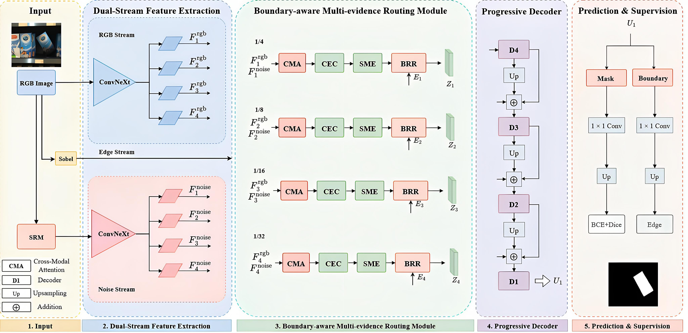

# BGER-Net

This repository contains the code for our paper:

### BGER-Net: A Lightweight Boundary-Guided Evidence Routing Network for Image Manipulation Localization

Lichao Su, Yucheng Yi, Kun Zou, Shiyan Tu



## Datasets

Training: [tampCOCO](https://www.kaggle.com/datasets/qsii24/tampcoco). Released by the [CAT-Net authors](https://github.com/mjkwon2021/CAT-Net#training), tampCOCO is a synthetic image-forgery dataset with pixel-level manipulation masks. We use it to train the model for image manipulation localization.

Testing:

- [CASIA v1](https://github.com/namtpham/casia1groundtruth) (community mirror with ground-truth masks; the original server is unavailable)
- [Columbia](https://www.ee.columbia.edu/ln/dvmm/downloads/authsplcuncmp/) (official download page)
- [COVERAGE](https://github.com/wenbihan/coverage) (author's dataset page)
- [NIST16](https://mfc.nist.gov/) (official NIST portal; registration and a data-use agreement may be required)

An example dataset organization is shown below. Before training, set `TRAIN_ROOTS` and `GENERALIZATION_ROOTS` in `train_bger.py` to the Owl-formatted directories you actually use.

```text
data/
  tampCOCO/
  nist16/
  columbia/
  coverage/
  casia_v1/
```

Each dataset directory referenced in the script uses the [Owl](https://github.com/aikwen/owl) v1 layout: `tp/` contains images, `gt/` contains masks, and `<folder-name>.json` lists matching filenames. For example, `data/casia_v1/casia_v1.json` can contain:

```json
[
  {"tp": "tampered.jpg", "gt": "tampered.png"},
  {"tp": "authentic.jpg", "gt": ""}
]
```

The corresponding files are `tp/tampered.jpg`, `gt/tampered.png`, and `tp/authentic.jpg`; an empty `gt` denotes an authentic image. Owl is included in this repository.

## Training

Install PyTorch for your system, then install the project dependencies:

```bash
pip install -r requirements.txt
```

Prepare the datasets as described above. A timm-compatible ImageNet-1K pretrained checkpoint is available from the [timm ConvNeXt-Tiny model page](https://huggingface.co/timm/convnext_tiny.fb_in1k/blob/main/pytorch_model.bin); download its `pytorch_model.bin` and place it at `pretrained/ConvNeXt-Tiny.pth`. From the repository root, run:

```bash
python train_bger.py
```

To use a checkpoint at another location, pass `--backbone-checkpoint PATH`. To continue an interrupted run, pass `--resume PATH` with a saved training checkpoint. Run `python train_bger.py --help` for the available options.
